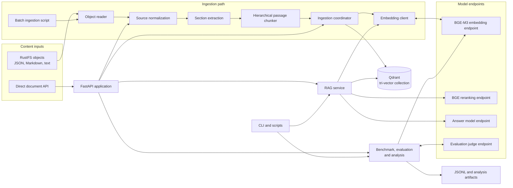
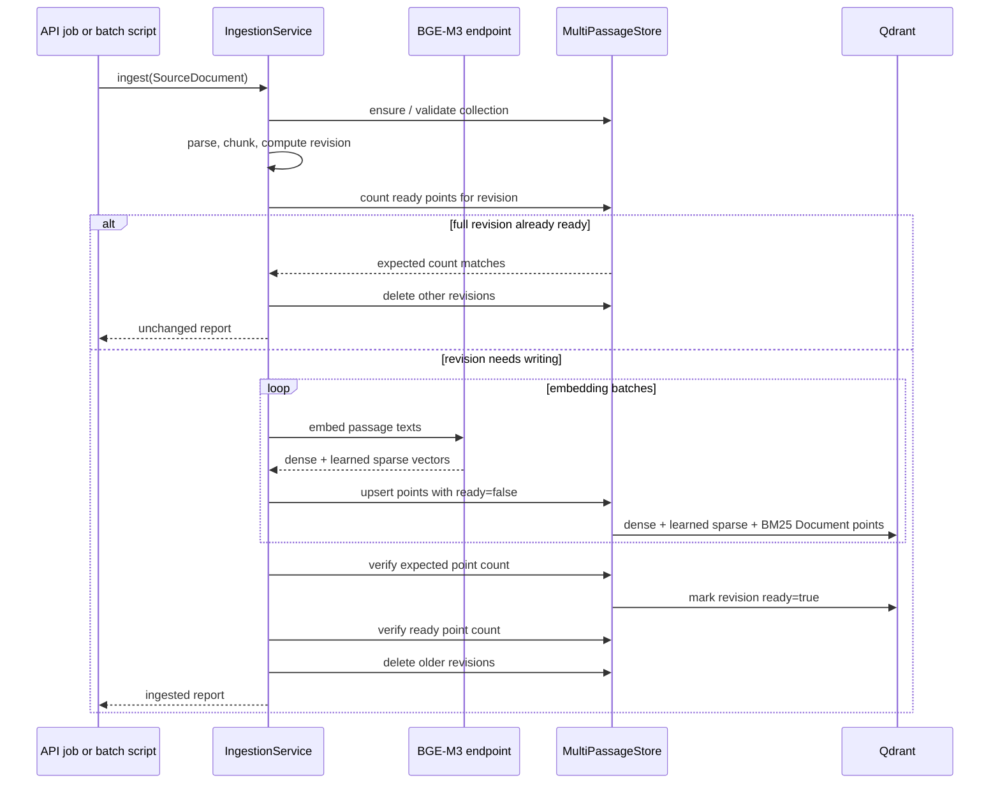
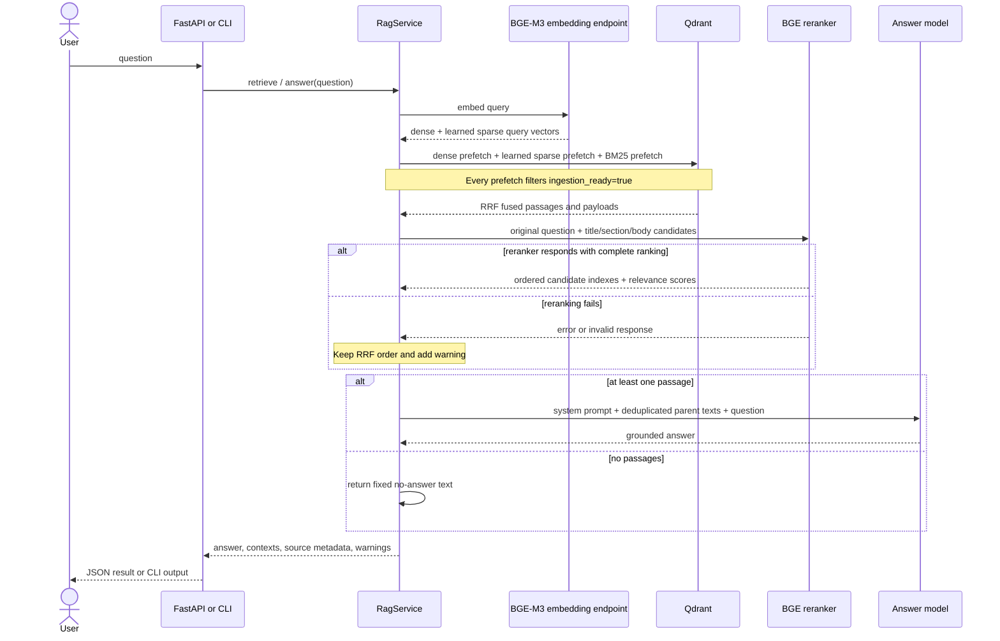

# Architecture

Elite RAG is a Python service and command-line application for indexing enterprise content,
retrieving relevant passages, and generating answers grounded in those passages. Qdrant is the
retrieval and passage store. RustFS is the object source for batch ingestion. Model inference
runs through separately configured embedding, reranking, answer, and evaluation endpoints.

This document describes the implementation in `src/elite_rag` and the batch utilities in
`scripts`. The commands are documented in [operation.md](operation.md), the terms in
[concepts.md](concepts.md), and exact metric behavior in [../ragas.md](../ragas.md).
The high-level flow is:

The diagram groups modules by responsibility. The API and CLI are entry points; they use the
same ingestion and RAG services where applicable. The API prefix-ingestion job and batch ingestion script list RustFS objects. Direct API
ingestion accepts one document payload, while `scripts/ingest_multi.py` performs an
independent sequential batch over configured source folders.

## Runtime components

| Component | Implementation | Responsibility |
| --- | --- | --- |
| HTTP application | `api.py` | FastAPI lifecycle, authentication middleware, endpoint validation, error mapping, and thread-offloaded work |
| Settings | `config.py` | `.env` loading, defaults, configuration validation, and ingestion pipeline signature |
| Source reader | `sources.py` | S3-compatible RustFS object listing, metadata lookup, byte reads, and source resolution from object key |
| Normalization and parsing | `parsing.py`, `documents.py` | Convert raw records to `SourceDocument`; emit heading-aware `Section` values |
| Chunking and tokens | `chunking.py`, `tokenization.py` | Preserve section context, split to token budgets, generate passage metadata and stable IDs |
| Embedding | `embedding.py` | Call the BGE-M3 embeddings API and validate response vectors |
| Collection and writes | `multi.py`, `store.py` | Enforce the tri-vector collection schema, index payload fields, write vectors and perform revision operations |
| Ingestion orchestration | `ingestion.py` | Batch embedding, passage upserts, verification, readiness commit, and replacement cleanup |
| Prefix job control | `jobs.py` | Queue, process, persist, resume, and report API RustFS prefix jobs |
| Retrieval and answer | `rag.py` | Three-channel search, RRF, BGE reranking, context assembly, and grounded answer generation |
| Quality workflow | `benchmark.py`, `evaluation.py`, `eval.py`, `retrieval_metrics.py`, `analyze.py` | Run benchmark questions, ask judge model for scores, summarize results, and export failure rows |
| Command line | `cli.py`, `scripts/` | Start the API and run RAG, benchmark, evaluation, analysis, ingestion, and retrieval utilities |

The package's `PassageStore` contains reusable Qdrant collection and revision operations.
The active application uses `MultiPassageStore`, which extends those operations with the
learned sparse and server-side BM25 vectors. The older two-vector schema helper remains in
`store.py`, but active tri-vector ingestion and retrieval validate and use `multi.py`.

## Ingestion architecture

### Input adapters and normalized document shape

`RustFSReader` reads `.json`, `.txt`, and `.md` objects. JSON records use declared
`title_field_name` and `content_field_names`; those fields become the title and content, and
remaining values become metadata. Text and Markdown use the first non-empty line as the title
and the remaining text as content. The object key and resolved source are retained. Source
names are inferred from configured path segments; an object key must contain exactly one
configured source segment, and an explicitly requested source must agree with it.

The API's direct-document endpoint creates the same `SourceDocument` form from the submitted
ID, content, source, title, and metadata. This keeps downstream parsing and indexing common
across source adapters.

### Section extraction and passage formation

The parser preserves structured field names. Within a field it recognizes Markdown heading
hierarchies, HTML headings and block elements, HTML and Markdown tables, lists, and fenced
code. It can split common source labels such as Jira's “Steps to reproduce” or GitHub's
“Testing” into additional section levels. Each section is represented by a field name, path,
and text.

The hierarchical chunker operates within sections to avoid crossing heading boundaries.
`MULTI_CHUNK_MAX_TOKENS` caps bodies (default 300); the body target is the maximum minus
effective overlap (default 260), with a minimum of 64. `BGE_EMBEDDING_MAX_LENGTH` caps
enriched embedding text (default 1024). Generic `CHUNK_TARGET_TOKENS` and `CHUNK_MAX_TOKENS`
are not this splitter's active body budgets. It uses the configured tokenizer; long
paragraphs or sentences are split further, while code fences are kept as blocks until they must be divided.
Passages may include a tail overlap from the previous passage in the same section. The
embedding text adds source and available entity context (for example project, repository,
issue, or space), title, and section path before the passage body. The original body remains
available separately for search payload and answer context.

Each child passage contains a deterministic point ID, parent document ID, ordinal, field and
section identity, parsed-section offsets where recoverable, token count, and metadata. Metadata
includes a content revision, pipeline signature, source and normalized entity attributes,
source metadata, and section evidence. The child is one Qdrant point; parent documents are
not separately vector-indexed. Payloads retain the parent document text when source fields are
plain strings, plus the full parsed section text for fallback context expansion.

### Vector generation and collection schema

The active path requires BGE-M3 and a 1024-dimension dense vector. Each chunk is sent to the
embedding endpoint in configured batches. The endpoint response supplies a dense vector and
BGE learned sparse indices and values. For the third vector, the application sends the
original passage body as a Qdrant `Document` input using `Qdrant/bm25`; Qdrant performs the
BM25 inference and applies IDF.

| Vector name (configurable) | Type and behavior | Input |
| --- | --- | --- |
| `dense` | 1024-dimensional dense vector, cosine distance | Context-enriched passage embedding text |
| `sparse` | BGE-M3 learned sparse vector, no modifier | Context-enriched passage embedding text |
| `sparse_bm25` | Qdrant BM25 sparse vector, IDF modifier | Original passage body, inferred by Qdrant |

The names above are defaults. `multi_settings()` requires all three names to be non-empty and
distinct, requires the BGE-M3 configuration, and requires the BM25 model to be
`Qdrant/bm25`. On collection creation, the store creates payload indexes for document ID,
source, project ID, revision, field name, section ID, and readiness. On reuse, it validates
the dense size/distance, sparse vector presence, and modifiers; incompatible schemas fail with a
collection schema error.

### Revision commit protocol

Revision identity combines a hash of document title, fields, metadata, and pipeline policy.
Point IDs are stable for the document, revision, and passage ordinal. Upserts mark points as
`ingestion_ready=false`, so partial work cannot enter normal retrieval. The coordinator then
checks the revision point count, marks every point in the revision ready, checks the ready
count, and removes other revisions for that document.

If an exception occurs before commit, the new points remain not ready and are excluded from
retrieval. Publication is not an atomic revision swap: new and old ready revisions may
coexist briefly before cleanup. A subsequent ingestion attempt can upsert the same
deterministic IDs and retry.
An unchanged revision is skipped only when the expected count of ready points is present. An
empty parsed document deletes all points with that document ID. `replace_existing` is passed
through as report and job behavior; actual passage replacement is governed by revision
comparison and the Qdrant write protocol.

### Batch and asynchronous ingestion

`scripts/ingest_multi.py` lists configured source folders under the selected RustFS prefix,
then processes objects sequentially. It writes a JSON report after each object, records
failures, and continues to later objects when an individual read or ingestion fails. Qdrant
revision checks allow safe reruns even if the script stops partway through.

The API prefix endpoint creates an ingestion job and returns its ID. `IngestionJobs` runs its
work in a background thread, reads RustFS objects, and uses object ETags for a fast unchanged
check before parsing. With `INGESTION_DATABASE_URL`, job state and object tracking are stored
in PostgreSQL; startup resumes jobs recorded as queued or running, and advisory locks prevent
multiple workers from processing the same resumed job concurrently. Without a database URL,
job and object state lives in process memory and does not survive restart. The API also
supports one RustFS object and direct document ingestion synchronously through the shared
ingestion service.

## Retrieval and answer architecture

`TriVectorRetriever` validates the configured collection, embeds a question once for dense
and learned sparse query vectors, then sends three Qdrant prefetch queries: dense, learned
sparse, and BM25 with the original question text. All three are filtered to
`ingestion_ready=true`. Qdrant combines their ranked candidates with reciprocal rank fusion
(RRF) and returns up to `RETRIEVAL_NUMBER` fused results.

`RagService` passes the original question and each child candidate's title, section path, and
text to the BGE reranking endpoint. A valid reranker response must rank every candidate exactly
once. The service maps ranked child hits to parent documents by parent document ID, deduplicates
parents in first-hit order, and applies `RERANK_TOP_N` to unique parents. It expands each parent
to its stored full text; if that text is unavailable, it uses retrieved section context and
adds a warning. If reranking fails, it applies the same parent expansion and cutoff to the
Qdrant fused order. No query expansion or query rewriting is performed.

The answer request includes the system instruction, deduplicated parent-document texts, and
original question. Thus `RERANK_TOP_N=5` means at most five unique parent contexts reach
generation, even when several high-ranking child hits belong to the same parent. The response returns the answer, parent
contexts, parent document IDs, matched child passage IDs/sections, rerank scores, and warnings.
When no valid parent context remains, the fixed no-answer response is returned without calling
the answer model.

## API and process boundaries

The FastAPI lifespan configures logging, initializes the ingestion job manager and Qdrant
collection, clears object tracking if the collection had to be newly created, and resumes
unfinished persisted jobs. Expensive synchronous retrieval, generation, ingestion, benchmark,
and evaluation work is dispatched with `asyncio.to_thread` by the endpoints.

When `API_KEY` is non-empty, middleware protects paths beginning with `/v1/` using a bearer
token comparison. `/health` and OpenAPI docs are outside that middleware check. External
service failures are generally logged and translated to HTTP errors; collection schema
mismatch is returned as a conflict during collection initialization.

The main endpoint groups are:

| Endpoint | Purpose |
| --- | --- |
| `GET /health` | Process health response |
| `POST /v1/retrieve` | Return ranked passages and warnings without answer generation |
| `POST /v1/rag` | Retrieve, rerank, and generate a grounded answer |
| `POST /v1/collections/initialize` | Create or validate collection; optional recreation |
| `POST /v1/ingest/document` | Ingest one supplied document |
| `POST /v1/ingest/rustfs/object` | Ingest one RustFS object |
| `POST /v1/ingest/rustfs/prefix` | Submit a background RustFS prefix job |
| `GET /v1/ingest/jobs/{job_id}` | Read job status and counters |
| `POST /v1/benchmark`, `/v1/eval`, `/v1/analyze` | Run batch quality workflows |
| `POST /v1/evaluate` | Score one supplied question, answer, context set, and gold answer |

The API uses cached service instances within a process for ingestion, jobs, and RAG. Qdrant
is accessed independently by ingestion and retrieval clients. The application does not
provide a shared transaction spanning PostgreSQL, Qdrant, and RustFS; object tracking is
recorded after Qdrant ingestion succeeds, and revision readiness is managed inside Qdrant.

## Benchmark and evaluation architecture

`benchmark.py` reads JSONL questions and sends each unprocessed question through `RagService`.
It appends results with answers, contexts, source records, warnings, and the gold answer to
the configured dataset file. It skips question IDs already present in the output and writes
a progress marker after each completed question.

`evaluation.py` uses imported RAGAS 0.4.3 prompt classes and Pydantic output schemas,
but executes ordinary chat completions and calculates the five metrics locally. It does not
execute the official metric classes. Record validation requires non-empty question, answer,
and reference strings and a non-empty string context list. Prompts execute sequentially;
malformed output gets one correction retry. A failure aborts the record without returning
partial scores. Relevancy and correctness additionally request dense vectors through the
hybrid embedding client. Exact formulas, prompt fields, and failure cases are specified in
[ragas.md](../ragas.md).

`eval.py` tags rows with `ragas-0.4.3-prompts-json-parent-context-v3`. It deduplicates input/output by
question ID, skips successful IDs, replaces errors on retry, and rewrites output through a
temporary file after each attempt. A successful preexisting row from a different implementation
rejects the destination. The batch return code is 0 even if individual rows failed; consumers
must inspect `evaluation_status`. ID-based resume does not detect changed answers or models.

`analyze.py` retains the latest row per question ID and summarizes successful judge scores,
writes a mean-score dashboard SVG, and exports successful records below the strict 0.30
faithfulness/context-recall thresholds. These exports are review lists, not verified failures.
`retrieval_metrics.py` independently computes expected parent-document ID coverage over final
saved sources, including judge-error rows with valid labels and IDs. It reports recall,
precision, target-document hit rate (any expected parent found), complete coverage, reciprocal
rank, cutoffs at 1/3/5 unique parent documents, and breakdowns by question/source type. Cutoff
aggregates score the first up to k parents; short or empty result lists remain in the
denominator as misses. Analysis writes numeric summaries and per-question details without calling models or checking implementation
consistency.

`scripts/multi_retrieval.py` is a separate diagnostic workflow: it reranks all fused child
candidates, then saves deduplicated parent-document rankings before/after reranking,
expected-document ranks, target-document hit@5 flags, and a manifest. It neither generates answers nor applies
`RERANK_TOP_N`. Its output is overwritten per invocation; reranking failures produce error
rows instead of the normal RAG fallback. Its ranks use unique parent document IDs, matching
the final-context analysis.

## Configuration and service dependencies

Settings are loaded from explicit settings values and `.env`; the settings class does not
read inherited shell variables or ambient secret files. The principal dependency boundaries
are:

| Service | Used for | Client configuration |
| --- | --- | --- |
| Qdrant | Collection, passage payloads, vector search, RRF, BM25 inference | `QDRANT_URL`, optional API key, collection and vector names |
| RustFS / S3 | Source object listing and reads | Endpoint, access key, secret, region, bucket, and prefix |
| BGE-M3 endpoint | Dense and learned sparse retrieval embeddings; dense evaluation embeddings for relevancy and correctness | Embedding base URL, model, dimension, and API key |
| BGE reranker | Candidate ordering against the question | `BGE_RERANK_URL`, timeout; model and max length are configured on the model service |
| Answer model | Final grounded answer | OpenAI-compatible base URL, model, temperature, token limit, API key |
| Evaluation judge | Benchmark metric judgments | Judge base URL, model, and API key |
| PostgreSQL (optional) | Durable API job state and object ETag tracking | `INGESTION_DATABASE_URL` |

BGE inference is implemented in the separately deployed `remotes/remote-models.py`; the
answer and judge model endpoints are external services. The defaults and operating procedures are maintained in [operation.md](operation.md).
